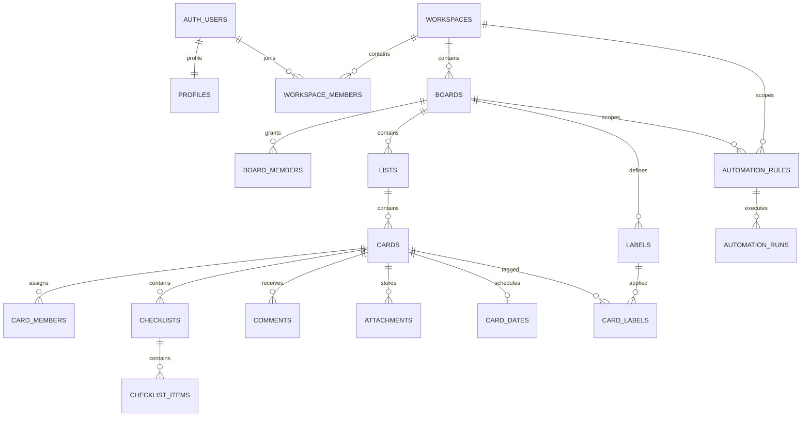

# Supabase database schema

This schema was reverse-engineered from the Trello feature requirement matrix and applied to the Supabase project **DB-OA-Project** (`frdtyfgmuyqsnlytjyfs`). The project had no application tables or migration history before deployment.

## Applied migrations

| Migration | Purpose |
|---|---|
| `202610210001_initial_schema.sql` | Creates the relational model, indexes, triggers, access helpers, RLS policies and private Storage policies. |
| `202610210002_explicit_worker_table_denies.sql` | Makes the client denial on the outbox and external ID map explicit. |
| `202610210003_split_read_write_rls_policies.sql` | Separates read and write policies to remove overlapping permissive policies while preserving access rules. |
| `202610210004_foreign_key_indexes.sql` | Adds left-prefix indexes for foreign keys not already covered by an index. |

All four migrations were recorded successfully. Verification found 57 public application tables, all with RLS enabled; the tables are empty because this is a new schema. The Supabase security advisor reported no findings. The performance advisor no longer reports unindexed foreign keys. It reports unused indexes, which is expected before the app has workload data; review those indexes against real query patterns before removing any.

## Model map

## Coverage

- **Core collaboration:** Supabase Auth-linked profiles, workspaces, membership, invitations, boards, lists, cards, assignments, labels, completion/archive states, dates/reminders, recurrence, checklists, comments/revisions, attachments, activity, notifications, inbox and saved views.
- **Customization and views:** custom field definitions and values, collections, saved searches/views, card/board templates, mirrors, dependencies, workflow policy and time entries.
- **Advanced services:** automation rules/runs, calendar connections and focus blocks, integrations, API credentials, webhooks/delivery records, import/export jobs and external-ID mapping.
- **Enterprise/optional:** organizations and policy, plans/subscriptions/invoices/usage, AI requests/drafts and merge operations.

## Permission model

- **Workspace roles:** `owner`, `admin`, `member`; **Board roles:** `admin`, `member`, `observer`.
- Workspace membership does not imply access to a private Board. Workspace-visible Boards can be read by workspace members, but board mutations still require board membership.
- Guests are workspace membership records with `member_kind='guest'`; Board-level access remains explicit.
- Observers can read and may comment when the Board policy allows. They cannot edit cards, lists or checklists.
- RLS is enabled across application tables. Client grants are constrained by policies; tables without a client policy stay inaccessible. `outbox_events`, `external_id_maps`, audit mutations, automation worker writes, AI generation/apply, billing mutations and webhook delivery writes are server-owned.
- `service_role` bypasses RLS. Keep its key in trusted server-side secrets only. Do not add the `private` schema to the Supabase exposed schemas list.
- `public` visibility is reserved in the schema, but anonymous Board access is not enabled. Enable it only after the organization policy and public-data rules are approved.

## Required application/server work

The database is ready, but application services are still needed for these flows:

1. Accept invitations through a trusted function that validates the hashed, single-use token, expiry and matching Auth email, then writes membership and audit data atomically.
2. Use version-checked updates for lists/cards (`id` plus expected `version`) so a stale edit becomes a visible conflict.
3. Dispatch outbox events after commit; generate notifications/reminders with deduplication keys and recheck access before delivery and read.
4. Validate custom-field JSON against the definition type/options; validate IANA time zones and date-only versus instant semantics.
5. Build Thai-aware search. The included `simple` full-text index is a baseline and needs a Thai tokenizer or an application search strategy for reliable Thai search.
6. Run attachment MIME/size validation and malware scanning before changing `scan_status` to `clean`. Generate short-lived authorized downloads.
7. Implement provider OAuth, secret storage, webhook signature/retry, import dry-run/commit, billing webhooks and AI draft/apply using trusted server functions.

## Supabase Storage setup

Create a **private** Storage bucket named `orbit-attachments` before uploads are enabled. Configure the approved file-size limit (the matrix proposes 25 MB) and allowed MIME types after the product owner confirms them. Object names must follow:

`<workspace_uuid>/<board_uuid>/<card_uuid>/<attachment_uuid>/<filename>`

The migration adds access policies on `storage.objects` for that bucket. Use the Storage API for file operations; do not insert, update or delete rows in Supabase's `storage` schema directly.

## Decisions still open in the source matrix

Confirm whether the product is internal-only or SaaS, public/guest access policy, file limits/provider, retention and purge windows, completion/Done semantics, recurrence edge cases, integration providers, AI provider/budget/data policy, hosting stack and production service targets. Proposed phase, retention and SLO values in the workbook are not approved commitments.

## References

- [Supabase Row Level Security](https://supabase.com/docs/guides/database/postgres/row-level-security)
- [Supabase Storage access control](https://supabase.com/docs/guides/storage/security/access-control)
- [Supabase Auth user management](https://supabase.com/docs/guides/auth/managing-user-data)
- [Supabase Storage schema guidance](https://supabase.com/docs/guides/storage/schema/design)
